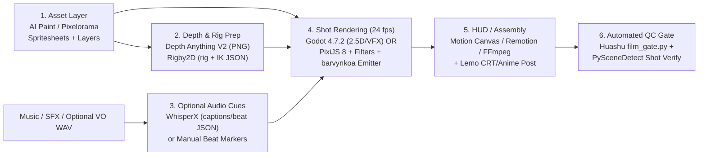

# Anime & 2.5D Pixel-Sprite Production Ranking & Interoperable Pipeline Blueprint

**Production Goal:** Extremely detailed, cinematic, 50–60 second anime and 2.5D pixel-sprite animations.  
**Asset Policy:** AI-generated individual assets, textures, characters, and sprite sheets are permitted; fully AI-generated video clips and static-image slideshows are prohibited.  
**Scope Status:** Research, benchmarking, and architecture evaluation only (`G:\AnimationLab` is completely decoupled from existing pipelines).

---

## 1. Usefulness Ranking for 50–60s Cinematic Anime & 2.5D Pixel-Sprite Production

### Tier S — Core Production Backbone
1. **Godot 4.7.2 + `#10 Godot Demo Projects` (`WORKING`)**
   - *Why Tier S:* Unmatched 2.5D pixel-sprite + camera + GPU lighting + `GPUParticles2D` + 3D/ortho parallax compositing in one engine with deterministic `--write-movie --fixed-fps 24` Vulkan output (`9.74s` for 96 frames on RTX 4060). Supports genuine Z-depth parallax cameras, normal maps, rim lighting, and frame-locked audio export.
2. **#6 PixiJS 8 + #7 PixiJS Filters + #8 `@barvynkoa/particle-emitter` (`WORKING` as v8 suite; do NOT use official `@pixi/particle-emitter@5.0.10`)**
   - *Why Tier S:* Ideal deterministic WebGL2 2D multi-plane renderer when authoring programmatic camera shakes, anime glow (`GlowFilter`), shockwaves (`ShockwaveFilter`), speed motion blur (`MotionBlurFilter`), twist impacts (`TwistFilter`), and additive aura sparks with frame-exact JS control.
3. **#5 Rigby2D (`WORKING`)**
   - *Why Tier S:* Bridges layered PSD/PNG illustration assets cleanly into 2D skeletal animation (`autorig`, IK constraints, physics hair/accessories, `.rigby` / JSON export), plus direct PixiJS 8 & Godot runtimes and an MCP server for scripted keyframing. Eliminates stiff cutout slideshows by giving limbs, capes, and hair physically believable secondary motion.
4. **#11 Depth Anything V2 (`WORKING` — `94.8 ms` CUDA, `414 MB` VRAM)**
   - *Why Tier S:* Converts painted backgrounds, matte paintings, or AI-generated individual environment illustrations into smooth grayscale depth maps (`depth_gray.png`). Enables genuine 2.5D depth-parallax displacement shaders and fog/DOF layering in Godot 4 or PixiJS 8 without turning backgrounds into flat panning cards.

### Tier A — Asset Prep, Style Prototypes, Audio Timing, Composition & Automated QC
5. **#9 Pixelorama (`WORKING`)**
   - Fast pixel-sprite editing, palette indexing, cel onion-skinning, and headless CLI sprite-sheet + JSON packing (`--spritesheet --export --json`) for Godot `AnimatedSprite2D` or PixiJS 8 sprites.
6. **#2 Huashu Art Motion (`WORKING` — especially `film_gate.py`)**
   - `film_gate.py` automatically detects slideshow stagnation (`blank_run_s`, `still_ratio`, `drift_ratio`, `fast_ratio`, `blue_purple_share`), enforcing the non-slideshow kinetic mandate on every rendered cut before assembly.
7. **#16 PySceneDetect (`WORKING` — `531.58 FPS`)**
   - Instant shot boundary verification (`-Scenes.csv`) and automatic storyboard contact thumbnail extraction on assembled cuts.
8. **#12 Remotion (`WORKING`)**
   - Strong React/TS timeline orchestrator for anime title cards, stylized OP/ED typography, chapter dividers, and multi-clip assembly when browser UI overlays or kinetic captions are needed.
9. **#1 Lemo-Opuscar (`WORKING` on hardware ANGLE)**
   - High-inspiration `styles/cel-anime-80s` shader presets (halftone shadows, CRT scanlines, whoosh events JSON) and Playwright frame-accurate capture harness.
10. **#14 WhisperX (`WORKING` — Optional for Subtitles / Cut Timing Only, No Lip-Sync)**
    - If a film uses voiceover or dialogue, WhisperX provides millisecond word timestamps (`speech_test.json`) and `.srt` captions for pacing cuts, title reveals, and impact flashes without any character mouth/lip-sync pipeline.

### Tier B — Specialized Vector / Math Inserts & Prototypes
11. **#15 Motion Canvas (`WORKING`)** — Clean TypeScript generator syntax (`yield*`) for HUD callouts, mech targeting UIs, magical circle diagrams, and anime infographic cutaways.
12. **#4 ManimGL (`PARTIALLY WORKING` — zero-LaTeX OpenGL)** — Best reserved for 3D geometric transformations, arcane glyph geometry, or crystal/orbit vector motion when pure math visuals are needed (no external LaTeX required for pure geometry/text).
13. **#3 Anidoodle (`PARTIALLY WORKING`)** — Useful architectural reference for pure-function seeded deterministic drawing (`PSNR` determinism verification), though its `gate.mjs` Windows `find.exe` collision makes it less plug-and-play than Lemo-Opuscar or PixiJS.

### Excluded from Production Pipeline
- **#13 Rhubarb Lip Sync (`WORKING` in lab — Excluded by Preference):** Tested and verified in `AnimationLab`, but excluded from the anime/2.5D pixel-sprite production workflow (no lip-sync stage).
- **Official `#8 @pixi/particle-emitter@5.0.10` (`BLOCKED` on PixiJS 8):** Superseded cleanly by `@barvynkoa/particle-emitter@0.0.1` or Godot `GPUParticles2D`.

---

## 2. Recommended Interoperable Architecture (50–60s Film Blueprint — No Lip-Sync)

All tools exchange **plain JSON, PNG/sprite sheets, grayscale depth PNGs, and high-bitrate MP4s**, keeping pipelines modular:

### Concrete Data Handshake Contracts Between Stages
1. **Asset -> Depth/Rig Stage:**
   - Environment painting (`background_plate.png`) -> `Depth Anything V2` -> `background_depth.png` (normalized 0–255 luminance -> UV parallax displacement shader in Godot 4 / PixiJS 8).
   - Layered character PSD / sprites -> `Pixelorama --spritesheet --export --json` (`frame` rects + durations) OR `Rigby2D import-psd / autorig` (`.rigby` / PixiJS 8 `rigby-pixi` bone hierarchy + attachment transforms).
2. **Audio -> Pacing / Captions (Optional, No Lip-Sync):**
   - Music/SFX cues drive camera impacts, shockwaves, and shot transitions directly. If narration/voiceover is used, `WhisperX` (`segments[].words[]` + `.srt`) supplies subtitle and cut-cue timing only—no viseme or mouth-shape animation.
3. **Shot Rendering -> Assembly -> QC Stage:**
   - Each 2–5s anime cut renders deterministically at **`24 fps`** (`--fixed-fps 24` in Godot; deterministic tick loop in PixiJS 8) with additive glow/shockwave/particles (`@barvynkoa/particle-emitter`).
   - Individual cuts assemble via `Remotion` or `FFmpeg` (with optional `Motion Canvas` HUD overlays), then pass through `PySceneDetect` (verify exact cut timestamps) and `Huashu film_gate.py --json` (`blank_run_s == 0`, low `still_ratio`, verified kinetic motion density) before final master export.
